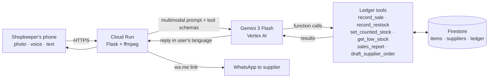

# ShelfTalk

**Talk to your shop's ledger.** ShelfTalk is an AI back-office for the millions of small
neighbourhood shops across Asia-Pacific: kiranas in India, warungs in Indonesia,
sari-sari stores in the Philippines, mom-and-pop shops in Vietnam and Thailand.

The shopkeeper does not fill in forms. They do what they already do: snap a photo of a
shelf or a supplier bill, send a voice note in their own language, or ask a question.
A Gemini agent turns that into a correct stock ledger, flags what is running low,
spots supplier price rises, and drafts reorder messages in each supplier's language,
ready to send on WhatsApp.

> Theme: **Retail & Commerce** · Google Cloud AI Builder Cup 2026

## The problem

- Small independent shops are the backbone of retail across JAPAC, and most track stock
  in a notebook (khata) or in their head.
- Inventory apps fail here because they demand typing, barcodes and English menus at a
  busy counter.
- The result: stock-outs on fast movers, money tied up in slow ones, missed supplier price
  rises, and no idea of real profit.

## What it does

| The shopkeeper sends | ShelfTalk does |
|---|---|
| 🎙 "10 Maggi aur 2 atta bik gaye, Gupta ji se 10 toor dal aayi ₹150 kilo" | Records 2 sales and 1 delivery, notices dal cost went ₹140 → ₹150 and warns the margin dropped |
| 📷 Photo of a supplier bill | Reads every line item and restocks each product at the billed cost |
| 📷 Photo of a shelf | Counts what it can clearly see, reconciles against the ledger, flags shrinkage |
| 📷 Photo of a handwritten khata page | Reads the entries and records them |
| "Jo kam hai uska order bana do" | Groups low items by supplier, suggests quantities from last week's sales, writes each order in the supplier's language with a one-tap WhatsApp link |
| "Is hafte kitna profit hua?" | Answers from the ledger with real numbers |
| Morning brief button | Yesterday and this week's sales and profit, top sellers, what to reorder, one suggestion |

Every action the agent takes is shown as a **"What I did" receipt** under its reply, and the
whole turn can be **undone in one tap**. The shopkeeper stays in control.

## How it works



- **Gemini 3 Flash** (with automatic fallback to 2.5 Flash) handles vision (bills, shelves,
  handwriting), speech (voice notes in any language), reasoning and replies, all in one model.
- **Agentic loop with function calling.** Gemini plans and calls 9 typed tools over the
  ledger, sees each result, and can chain calls (for example list → match → record → check
  low stock) before answering. The loop preserves Gemini 3 thought signatures.
- **Grounded by design.** The model never edits numbers directly. Every change goes through
  a tool that validates it, fuzzy-matches product names (English, Hindi, Hinglish aliases),
  and writes a ledger entry tagged with the turn's ID, which is what makes undo possible.
- **Cloud Run** for serverless hosting (scales to zero), **Firestore** for durable state,
  **Vertex AI** for Gemini with no API keys in the app.

## Run it

### Deploy to Google Cloud (5 minutes, in Cloud Shell)

```bash
gcloud config set project YOUR_PROJECT_ID
chmod +x deploy.sh && ./deploy.sh                 # Gemini via Vertex AI (recommended)
# or: GEMINI_API_KEY=your_key ./deploy.sh         # Gemini API key from aistudio.google.com
```

The script enables the APIs, creates the Firestore database, grants the service account
access, builds the container and prints the live URL.

### Run locally

```bash
pip install -r requirements.txt
export GEMINI_API_KEY=your_key
python -m app.main            # http://localhost:8080  (stores data in /tmp/shelftalk_db.json)
```

### Tests

```bash
python tests/test_app.py
```

The tests drive the full agent loop and HTTP API with a scripted fake Gemini client, so
they run offline.

## Project layout

```
app/agent.py       Gemini agent loop, tool definitions and system prompt
app/store.py       Ledger logic + Local JSON / Firestore backends
app/main.py        Flask API (turn, brief, undo, state), voice-note conversion
app/seed_data.json Demo shop: 16 products, 4 suppliers, 7 days of sales
static/index.html  Mobile-first web app (no build step)
deploy.sh          One-command Cloud Run deploy
```

## Configuration

| Variable | Default | Purpose |
|---|---|---|
| `STORE` | `local` | `firestore` on Cloud Run |
| `GEMINI_MODELS` | `gemini-3-flash-preview,gemini-2.5-flash` | Models tried in order |
| `GOOGLE_GENAI_USE_VERTEXAI` | unset | `true` to use Vertex AI instead of an API key |
| `SHOP_ID` | `demo-shop` | Firestore document for the shop |

## What's next

- WhatsApp Business API, so shopkeepers use ShelfTalk without opening any app
- Multi-shop accounts and a distributor view (which shops will need stock next week)
- Credit (udhaar) tracking for regular customers
- Demand forecasting from ledger history with BigQuery

## License

MIT
